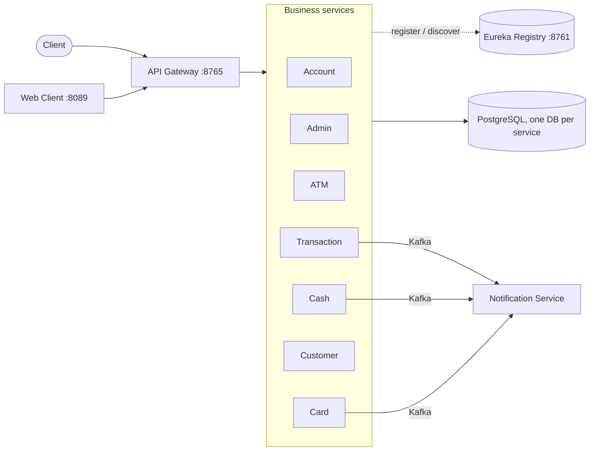

# ATM Microservices

A distributed ATM management system built with **Java 21**, **Spring Boot**, **Spring Cloud**, **PostgreSQL**, **Apache
Kafka**, and **Docker**.

Each business service owns its own database and talks to the others through synchronous REST calls (OpenFeign) or
asynchronous events (Kafka). The project is meant to demonstrate a realistic microservices setup: service discovery, an
API gateway, database-per-service, event-driven notifications, idempotent operations, and compensation-based transfers.

## Table of Contents

- [Features](#features)
- [Architecture](#architecture)
- [Tech Stack](#tech-stack)
- [Quick Start](#quick-start)
- [Services and Ports](#services-and-ports)
- [Data Management](#data-management)
- [Inter-Service Communication](#inter-service-communication)
- [Reliability: Idempotency and Compensation](#reliability-idempotency-and-compensation)
- [Running Without Docker](#running-without-docker)
- [Build and Test](#build-and-test)
- [Troubleshooting](#troubleshooting)
- [License](#license)

## Features

- Account management and balances
- Customer, card, and ATM terminal management
- Cash inventory tracking and withdrawals
- Transactions, transfers, and refunds
- Real-time notifications over WebSocket / STOMP
- Kafka-driven alerts for completed transactions, low cash, and card events
- Admin operations and a web client
- Idempotency keys to protect against duplicate requests

## Architecture



Every data-owning service has its own database, and services never access another service's database directly.

## Tech Stack

| Technology           | Purpose                          |
|----------------------|----------------------------------|
| Java 21              | Programming language             |
| Spring Boot          | Microservice framework           |
| Spring Cloud Gateway | API gateway                      |
| Netflix Eureka       | Service discovery                |
| OpenFeign            | Inter-service REST communication |
| Spring Data JPA      | Persistence                      |
| PostgreSQL           | Relational database              |
| Flyway               | Database migrations              |
| Apache Kafka         | Asynchronous messaging           |
| Spring Security      | Security configuration           |
| WebSocket / STOMP    | Real-time notifications          |
| Maven                | Build and dependency management  |
| Docker Compose       | Container orchestration          |

## Quick Start

### Prerequisites

- Java 21
- Maven 3.9+
- Docker Engine or Docker Desktop, with Docker Compose

### 1. Clone and configure

```bash
git clone <your-repo-url>
cd <your-repo-directory>
cp .env.example .env
```

Edit `.env`:

```env
POSTGRES_USER=your_username
POSTGRES_PASSWORD=your_secure_password

# Optional: email notifications
MAIL_USERNAME=
MAIL_PASSWORD=
ADMIN_EMAIL=
```

> **Warning:** Never commit `.env` or share it publicly.

### 2. Start everything

```bash
docker compose up --build -d
```

### 3. Verify

```bash
docker compose ps
```

Open the Eureka dashboard at <http://localhost:8761> and confirm every service has registered. Send client requests
through the API Gateway at <http://localhost:8765>.

### Useful commands

```bash
docker compose logs -f                        # all logs
docker compose logs -f transaction-service    # a single service
docker compose down                           # stop
```

## Services and Ports

| Service              | Port | Responsibility                      |
|----------------------|-----:|-------------------------------------|
| API Gateway          | 8765 | Entry point for client requests     |
| Service Registry     | 8761 | Eureka service discovery            |
| Account Service      | 8081 | Account management and balances     |
| Admin Service        | 8082 | Administrative operations           |
| ATM Service          | 8083 | ATM terminal operations             |
| Card Service         | 8084 | Card management and authentication  |
| Cash Service         | 8085 | Cash inventory and withdrawals      |
| Customer Service     | 8086 | Customer management                 |
| Notification Service | 8087 | Notifications and Kafka consumers   |
| Transaction Service  | 8088 | Transactions, transfers and refunds |
| Web Client           | 8089 | Web interface                       |

Infrastructure: PostgreSQL on `5432`. Kafka on `9092` inside Docker and `29092` for applications running on the host.

All services are reachable at `http://localhost:<port>`, but normal client traffic should go through the API Gateway.

## Data Management

Each data-owning service has a dedicated PostgreSQL database:

| Service             | Database         |
|---------------------|------------------|
| Account Service     | `account_db`     |
| Admin Service       | `admin_db`       |
| ATM Service         | `atm_db`         |
| Card Service        | `card_db`        |
| Cash Service        | `cash_db`        |
| Customer Service    | `customer_db`    |
| Transaction Service | `transaction_db` |

Schema changes are managed with **Flyway** migrations in `src/main/resources/db/migration/` within each service.
Hibernate runs with `ddl-auto: validate`, so it checks the schema but never modifies it:

```yaml
spring:
  jpa:
    hibernate:
      ddl-auto: validate
```

## Inter-Service Communication

### Synchronous: OpenFeign

Used when a service needs an immediate answer. Services are located through Eureka by their registered names.

- Transaction Service calls Account Service to debit or credit accounts and to fetch account details for receipts.
- Card Service fetches account and customer information.
- ATM Service communicates with Card Service.
- Admin Service communicates with Account, ATM, and Card Services.

```java

@FeignClient(name = "account-service")
public interface AccountServiceClient {
    // Account Service endpoints
}
```

### Asynchronous: Kafka

Used for business events that do not need an immediate response. Events are JSON messages, keyed by the relevant
account, ATM, or card.

| Topic                        | Producer            | Consumer             |
|------------------------------|---------------------|----------------------|
| `atm.transactions.completed` | Transaction Service | Notification Service |
| `atm.cash.low`               | Cash Service        | Notification Service |
| `atm.card.events`            | Card Service        | Notification Service |

The Notification Service consumes these events and routes notifications to the appropriate destination.

## Reliability: Idempotency and Compensation

- **Idempotency keys** protect against duplicate requests. Account Service records processed operations in its
  `account_operation` table, and Transaction Service stores its own transaction idempotency keys.
- **Compensation logic** handles transfer failures: if crediting the destination account fails after the source account
  was debited, the debit is compensated.

> **Note:** This is a basic distributed transaction strategy, not a fully atomic distributed transaction.

## Running Without Docker

Start only the infrastructure in Docker:

```bash
docker compose up -d postgres kafka
```

Then start each service from its module directory:

```bash
mvn spring-boot:run
```

Recommended startup order:

1. Service Registry
2. Account, Customer, and other business services
3. Transaction, Card, Cash, and Admin services
4. Notification Service
5. Web Client
6. API Gateway

Host applications should connect to:

```text
PostgreSQL: localhost:5432
Kafka:      localhost:29092
Eureka:     localhost:8761
```

## Build and Test

```bash
mvn clean package                  # build all modules
mvn clean package -DskipTests      # build without tests
mvn test                           # run tests
```

Some application-context tests require a running PostgreSQL instance.

## Troubleshooting

| Problem                             | What to check                                                                                             |
|-------------------------------------|-----------------------------------------------------------------------------------------------------------|
| Admin login returns `401`           | Confirm the admin exists in `admin_db`. Flyway does not re-run seed migrations that were already applied. |
| Transaction receipt returns `404`   | Confirm the transaction exists in `transaction_db` and its account ID exists in `account_db`.             |
| Services cannot discover each other | Open <http://localhost:8761> and verify all services registered.                                          |
| Kafka connection errors             | Run `docker compose ps kafka`. Use `kafka:9092` from containers and `localhost:29092` from the host.      |
| Database schema errors              | Inspect Flyway migration logs and verify the service is connecting to the right database.                 |

### Reset the development environment

```bash
docker compose down -v
docker compose up --build -d
```

> **Warning:** This deletes the PostgreSQL and Kafka volumes, including all stored data.